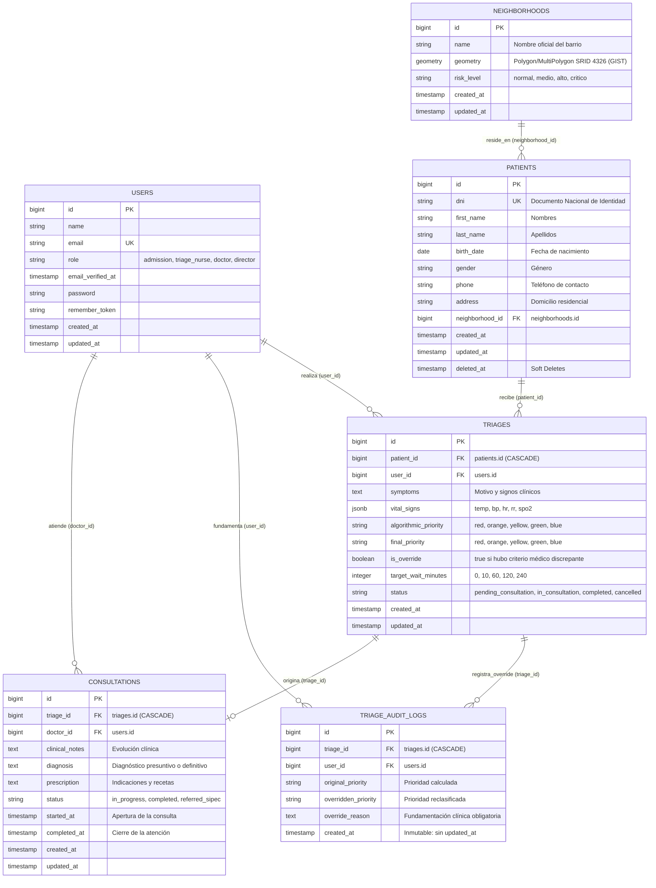

# 🗄️ Diccionario de Base de Datos y Diagrama Entidad-Relación (CEN-14)

**Motor:** PostgreSQL 18 + PostGIS 3.7 (`postgis/postgis:18-3.7`)  
**Esquema Principal:** `centinela`  
**SRID Espacial:** 4326 (WGS 84 - Coordenadas Geográficas)  
**Convención de Nombres:** snake_case en plural para tablas, singular para claves foráneas.

---

## 1. Diagrama Entidad-Relación (ERD)

---

## 2. Diccionario Detallado de Tablas

### 2.1. `neighborhoods`
Barrios de Formosa Capital con delimitación poligonal espacial e indicador de riesgo epidemiológico.

| Columna | Tipo de Dato | Nulo | Default | Restricciones / Índices | Descripción |
| :--- | :--- | :---: | :---: | :--- | :--- |
| `id` | `BIGSERIAL` | No | Auto | **PK** | Identificador único del barrio. |
| `name` | `VARCHAR(255)` | No | - | - | Nombre oficial del barrio. |
| `geometry` | `GEOMETRY(GEOMETRY, 4326)` | No | - | **GIST** (`spatialIndex`) | Polígono o multipolígono georreferenciado en WGS 84. |
| `risk_level` | `VARCHAR(255)` | No | `'normal'` | - | Nivel de riesgo epidemiológico asignado por vigilancia. |
| `created_at` | `TIMESTAMP` | Sí | `NULL` | - | Marca de tiempo de inserción. |
| `updated_at` | `TIMESTAMP` | Sí | `NULL` | - | Marca de tiempo de última modificación. |

---

### 2.2. `patients`
Padrón local de pacientes atendidos en el Centro de Atención Primaria de la Salud (CAPS).

| Columna | Tipo de Dato | Nulo | Default | Restricciones / Índices | Descripción |
| :--- | :--- | :---: | :---: | :--- | :--- |
| `id` | `BIGSERIAL` | No | Auto | **PK** | Identificador único del paciente. |
| `dni` | `VARCHAR(20)` | No | - | **UNIQUE** | Documento Nacional de Identidad del paciente. |
| `first_name` | `VARCHAR(100)` | No | - | - | Nombres del paciente. |
| `last_name` | `VARCHAR(100)` | No | - | - | Apellidos del paciente. |
| `birth_date` | `DATE` | No | - | - | Fecha de nacimiento para cálculo dinámico de edad. |
| `gender` | `VARCHAR(20)` | No | - | - | Identidad de género o sexo registral. |
| `phone` | `VARCHAR(50)` | Sí | `NULL` | - | Teléfono o celular de contacto. |
| `address` | `VARCHAR(255)` | No | - | - | Dirección particular o calle y número. |
| `neighborhood_id` | `BIGINT` | No | - | **FK** ➔ `neighborhoods.id` (RESTRICT) | Barrio de residencia dentro del área programática. |
| `created_at` | `TIMESTAMP` | Sí | `NULL` | - | Marca de tiempo de registro. |
| `updated_at` | `TIMESTAMP` | Sí | `NULL` | - | Marca de tiempo de última actualización. |
| `deleted_at` | `TIMESTAMP` | Sí | `NULL` | - | Marca de borrado lógico (Soft Deletes). |

---

### 2.3. `triages`
Evaluaciones clínicas de admisión y categorización bajo el Sistema Manchester de Triage (MTS).

| Columna | Tipo de Dato | Nulo | Default | Restricciones / Índices | Descripción |
| :--- | :--- | :---: | :---: | :--- | :--- |
| `id` | `BIGSERIAL` | No | Auto | **PK** | Identificador único de la evaluación de triage. |
| `patient_id` | `BIGINT` | No | - | **FK** ➔ `patients.id` (CASCADE) | Paciente evaluado. |
| `user_id` | `BIGINT` | No | - | **FK** ➔ `users.id` (RESTRICT) | Profesional que efectuó la admisión/triage. |
| `symptoms` | `TEXT` | No | - | - | Motivo de consulta y sintomatología clínica referida. |
| `vital_signs` | `JSONB` | No | - | - | Signos vitales: temp, bp sistólica/diastólica, hr, rr, spo2. |
| `algorithmic_priority` | `VARCHAR(20)` | No | - | - | Prioridad determinada por el árbol de decisión MTS. |
| `final_priority` | `VARCHAR(20)` | No | - | **INDEX** | Prioridad definitiva tras confirmación o Clinical Override. |
| `is_override` | `BOOLEAN` | No | `false` | - | Indicador de reclasificación clínica manual. |
| `target_wait_minutes` | `INTEGER` | No | `120` | - | Tiempo máximo de espera en minutos (0, 10, 60, 120, 240). |
| `status` | `VARCHAR(30)` | No | `'pending_consultation'` | **INDEX** | Estado del flujo: pendiente, en atención, completado. |
| `created_at` | `TIMESTAMP` | Sí | `NULL` | - | Marca de tiempo de ingreso. |
| `updated_at` | `TIMESTAMP` | Sí | `NULL` | - | Marca de tiempo de actualización de estado. |

---

### 2.4. `triage_audit_logs`
Bitácora inmutable de auditoría para decisiones clínicas de *Clinical Override*.

| Columna | Tipo de Dato | Nulo | Default | Restricciones / Índices | Descripción |
| :--- | :--- | :---: | :---: | :--- | :--- |
| `id` | `BIGSERIAL` | No | Auto | **PK** | Identificador del registro inmutable de auditoría. |
| `triage_id` | `BIGINT` | No | - | **FK** ➔ `triages.id` (CASCADE) | Triage intervenido con override. |
| `user_id` | `BIGINT` | No | - | **FK** ➔ `users.id` (RESTRICT) | Profesional médico que fundamentó la reclasificación. |
| `original_priority` | `VARCHAR(20)` | No | - | - | Nivel de prioridad calculado previamente por algoritmo. |
| `overridden_priority` | `VARCHAR(20)` | No | - | - | Nuevo nivel de prioridad asignado por criterio médico. |
| `override_reason` | `TEXT` | No | - | - | Fundamentación clínica obligatoria requerida por protocolo. |
| `created_at` | `TIMESTAMP` | No | `CURRENT_TIMESTAMP` | - | Momento exacto de la reclasificación (**sin updated_at**). |

---

### 2.5. `consultations`
Atención y evolución médica efectuada en consultorio de guardia de CAPS.

| Columna | Tipo de Dato | Nulo | Default | Restricciones / Índices | Descripción |
| :--- | :--- | :---: | :---: | :--- | :--- |
| `id` | `BIGSERIAL` | No | Auto | **PK** | Identificador de la consulta médica. |
| `triage_id` | `BIGINT` | No | - | **FK** ➔ `triages.id` (CASCADE) | Triage clínico que originó el llamado a consulta. |
| `doctor_id` | `BIGINT` | No | - | **FK** ➔ `users.id` (RESTRICT) | Médico de guardia responsable de la atención. |
| `clinical_notes` | `TEXT` | Sí | `NULL` | - | Anamnesis, examen físico y notas de evolución. |
| `diagnosis` | `TEXT` | Sí | `NULL` | - | Diagnóstico clínico presuntivo o CIE-10/CIE-11. |
| `prescription` | `TEXT` | Sí | `NULL` | - | Indicaciones terapéuticas, fármacos y dosis. |
| `status` | `VARCHAR(30)` | No | `'in_progress'` | **INDEX** | Estado: `in_progress`, `completed`, `referred_sipec`. |
| `started_at` | `TIMESTAMP` | No | `CURRENT_TIMESTAMP` | - | Momento en que el médico inició el llamado del paciente. |
| `completed_at` | `TIMESTAMP` | Sí | `NULL` | - | Momento de cierre o derivación de la consulta. |
| `created_at` | `TIMESTAMP` | Sí | `NULL` | - | Marca de creación del registro. |
| `updated_at` | `TIMESTAMP` | Sí | `NULL` | - | Marca de última modificación. |
